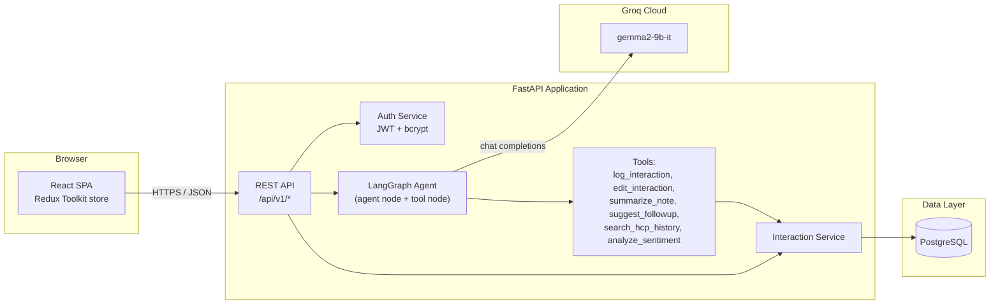
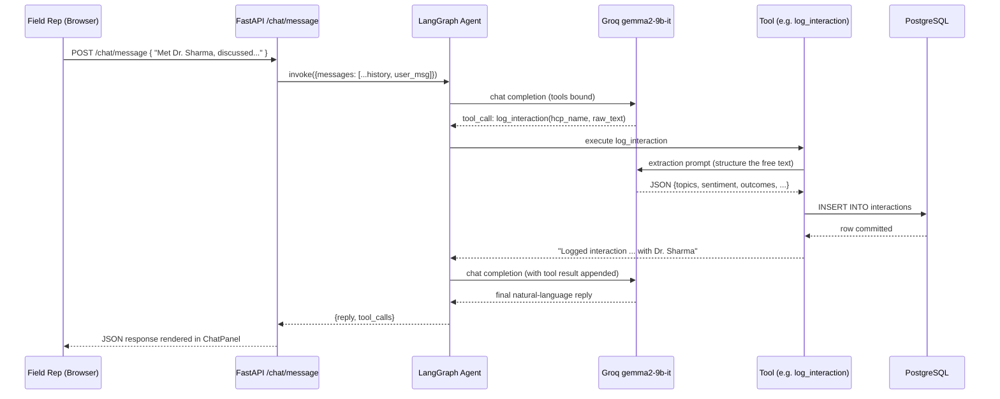

# Vitals CRM — AI-First HCP Interaction Module

An enterprise-grade, AI-first CRM module for pharmaceutical field representatives to log,
edit, and review interactions with Healthcare Professionals (HCPs) — through a structured
form **or** a conversational chat interface backed by a **LangGraph** agent running on
**Groq's `gemma2-9b-it`**.

Built for the Naukri "AI-First CRM HCP Module – Log Interaction Screen" technical assignment.

---

## ✨ Highlights

- **Dual logging UX** — structured form and natural-language chat both write to the same
  data model, side by side, exactly as specified in the assignment mockup.
- **LangGraph AI agent** with 6 purpose-built tools (2 mandatory + 4 supporting), each
  independently testable and swappable.
- **Production-shaped backend**: FastAPI, layered architecture (routes → services → models),
  Pydantic validation, JWT auth, structured logging, centralized error handling.
- **Modern SaaS frontend**: React + Redux Toolkit, dark/light theme, Google Inter typography,
  Framer Motion micro-interactions, a signature "pulse line" motif tying the health-monitoring
  metaphor to the AI assistant's thinking state.
- **Fully containerized**: one `docker compose up` boots Postgres, the API, and the web app.

---

## 🏗️ Tech Stack

| Layer            | Technology                                      |
|-------------------|--------------------------------------------------|
| Frontend          | React 18, Redux Toolkit, React Router, Framer Motion, Vite |
| Backend           | FastAPI (Python 3.11)                            |
| AI Agent Framework| LangGraph                                         |
| LLM               | Groq `gemma2-9b-it` (fallback: `llama-3.3-70b-versatile`) |
| Database          | PostgreSQL 16                                     |
| ORM               | SQLAlchemy 2.0 (typed models)                     |
| Validation        | Pydantic v2                                       |
| Auth              | JWT (OAuth2 password flow)                        |
| Containerization  | Docker + docker-compose                           |
| Font              | Google Inter                                      |

---

## 📐 Architecture



### Backend folder structure

```
backend/
├── app/
│   ├── main.py                # FastAPI app factory, middleware, startup
│   ├── core/                  # config, security, logging, error handlers
│   ├── db/                    # engine/session, init_db + seed script
│   ├── models/                # SQLAlchemy ORM models (User, HCP, Interaction)
│   ├── schemas/                # Pydantic request/response schemas
│   ├── api/
│   │   ├── deps.py            # shared FastAPI dependencies (auth)
│   │   └── v1/routes/         # auth, hcp, interactions, chat, health
│   ├── services/               # business logic, decoupled from routes
│   └── agents/                 # LangGraph graph, tools, prompts, LLM client
├── scripts/entrypoint.sh       # wait-for-db + migrate + seed + serve
├── requirements.txt
├── Dockerfile
└── .env.example
```

### Frontend folder structure

```
frontend/
├── src/
│   ├── app/store.js             # Redux Toolkit store
│   ├── api/                     # axios client + typed API modules
│   ├── features/                # auth, theme, interactions, chat slices
│   ├── components/               # Sidebar, ChatPanel, InteractionForm, PulseLine...
│   ├── pages/                    # Login, Signup, Dashboard, LogInteraction
│   └── styles/global.css         # design tokens (light/dark), primitives
├── deploy/nginx.conf
├── Dockerfile
└── .env.example
```

---

## 🤖 The LangGraph Agent

The agent is a small ReAct-style graph: `agent` node calls the Groq LLM with tools bound;
if the model requests a tool call, control passes to a `tools` node, the result is appended
to the transcript, and control returns to `agent` — looping until the model responds with
plain text.



### Tools implemented (`app/agents/tools.py`)

| Tool                  | Required? | Purpose                                                                 |
|------------------------|-----------|--------------------------------------------------------------------------|
| `log_interaction`      | ✅ Mandatory | Extracts structured fields (topics, sentiment, materials, outcomes) from free text via the LLM and persists a new `Interaction` row. |
| `edit_interaction`     | ✅ Mandatory | Updates a single field on a previously logged interaction, scoped to the requesting user. |
| `summarize_note`       | Supporting | Turns a long/rambling voice-note transcript into crisp bullet points before logging. |
| `suggest_followup`     | Supporting | Proposes 2–4 concrete next-step actions based on the interaction's topics/outcomes/sentiment. |
| `search_hcp_history`   | Supporting | Retrieves an HCP's recent interaction history so the rep (or agent) has context. |
| `analyze_sentiment`    | Supporting | Classifies HCP sentiment (Positive/Neutral/Negative) from raw text. |

All prompt text lives in `app/agents/prompts.py`, fully decoupled from orchestration logic.

---

## 🔐 Authentication

Standard OAuth2-password-flow JWT auth:

- `POST /api/v1/auth/signup` — create an account (field rep / manager / admin)
- `POST /api/v1/auth/login` — obtain a bearer token
- `GET /api/v1/auth/me` — current user

Tokens are stored client-side and attached via an axios interceptor; a 401 response
anywhere triggers an automatic redirect to `/login`.

---

## 🚀 Getting Started

See **[QUICKSTART.md](./QUICKSTART.md)** for the fastest path to a running system
(Docker, one command). For manual/local dev setup, environment variables, and API
documentation links, see the same file.

---

## 📄 API Documentation

Once the backend is running, interactive docs are available at:

- Swagger UI: `http://localhost:8000/api/docs`
- ReDoc: `http://localhost:8000/api/redoc`
- OpenAPI schema: `http://localhost:8000/api/openapi.json`

---

## 🧪 Sample Data

`app/db/init_db.py` seeds one demo user and three demo HCPs on first boot:

- **Login:** `rep@demo.io` / `Demo@1234`
- HCPs: Dr. Ritu Sharma (Oncology), Dr. Karan Mehta (Cardiology), Dr. Neha Kapoor (Endocrinology)

---

## 🎨 Design System

- **Typography:** Google Inter across the UI (mandated by the assignment), JetBrains Mono
  for IDs/timestamps/tool output.
- **Palette:** clinical blue (`--primary`) for trust/action, vital teal (`--accent`) for
  positive/AI signal, with full light/dark token pairs in `src/styles/global.css`.
- **Signature element:** the *pulse line* — an animated heartbeat trace (`PulseLine.jsx`)
  used as a brand mark and as the AI assistant's "thinking" indicator, visually tying the
  health-monitoring domain to the AI actively processing the conversation.

---

## 🛣️ Suggested Next Steps for Production

- Replace `Base.metadata.create_all` with versioned Alembic migrations.
- Add refresh tokens + rate limiting on `/auth/login`.
- Add a `pytest` suite (unit tests for services/tools, integration tests for routes).
- Stream chat responses (SSE/WebSocket) instead of a single blocking response.
- Add role-based access control on manager/admin-only endpoints.
- Wire an APM/log aggregator (the structured JSON logs are ready for this).
